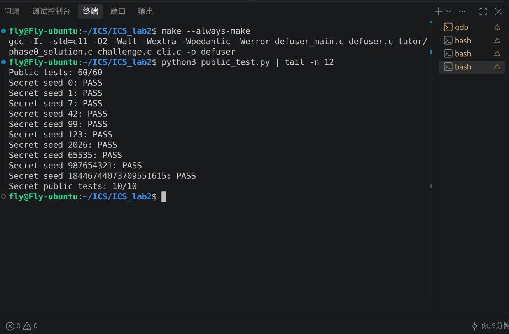
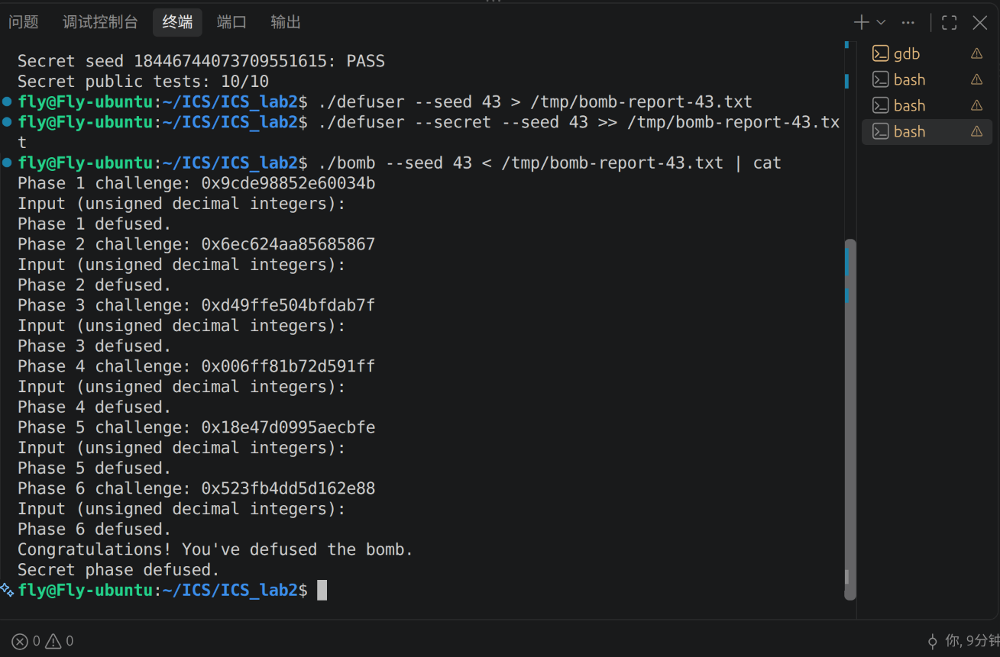

# Lab2：BombLab 实验报告

实验日期：2026 年 10 月 30 日

完成范围：六个正式关卡及 Honor（Secret）关卡

实现文件：[defuser.c](defuser.c)

## 1. 实验环境与基本思路

这次实验需要阅读个人 `bomb` 的汇编，弄清每关怎样检查输入，再在 `defuser.c` 中写出根据 `challenge` 计算答案的过程。Honor 还用到了由前六关答案计算出的 `context`。下面记录各关的主要计算关系和验证结果，所用常量与表内容都来自这份个人炸弹。实验要求参考[课程说明](https://ics-26fall-fdu.github.io/labs/lab2-bomb-lab/)和仓库 [README](README.md)。

实验环境如下。

| 项目 | 环境 |
| --- | --- |
| 操作系统及架构 | Ubuntu 26.04.1 LTS，Linux x86-64 |
| GCC | 15.2.0 |
| GDB | 17.1 |
| Python | 3.14.4 |
| 编译参数 | `-std=c11 -O2 -Wall -Wextra -Wpedantic -Werror` |

分析时主要用 GDB 的 `disassemble` 看汇编，结合断点和 `x` 命令查看寄存器、跳转表和链表节点。命令用法参考 GDB 官方文档中的[反汇编](https://sourceware.org/gdb/current/onlinedocs/gdb.html/Machine-Code.html)和[内存查看](https://sourceware.org/gdb/current/onlinedocs/gdb.html/Memory.html)部分。函数接口和题目生成方式对照了 [defuser_main.c](defuser_main.c)、[challenge.c](challenge.c)，测试使用仓库自带的 [public_test.py](public_test.py)。

### 1.1 记号约定

为了让公式短一些，下文用 `C` 表示 64 位 `challenge`，用 `T` 表示 Honor 的 64 位 `context`：

```text
u32(x) = x 的低 32 位
lo(C)  = u32(C)
hi(C)  = u32(C >> 32)
```

汇编中很多运算只使用 32 位寄存器，所以对应的中间变量使用 `uint32_t`。加、减、乘运算保留低 32 位，右移按无符号数处理。对 `C`、`T` 提取位段时，则先进行 64 位移位，再截取需要的部分。

### 1.2 炸弹检查函数与求解函数的关系

`bomb` 中的 `phase_0N` 接收输入文本和 `challenge`，解析后比较输入是否正确；`defuser.c` 中的 `solve_phase_N(challenge, out, cap)` 根据题目生成口令。

在这里使用的 x86-64 调用约定中，前几个整数或指针参数依次放在 `%rdi`、`%rsi`、`%rdx`、`%rcx`、`%r8`、`%r9` 中。这个区别在读代码时很重要：`phase_0N` 入口处的 `%rdi` 是输入文本地址，`%rsi` 是 `challenge`；而计算函数若把 `challenge` 作为第一个参数，入口处的 `%rdi` 就保存这个数。判断寄存器含义时，需要先看当前在哪个函数里。

普通关卡将答案写入 `values`，由 `write_answer` 格式化为无符号十进制整数文本。`out` 中不添加换行，驱动的 `puts` 负责输出换行。成功返回 `0`，格式化失败或缓冲区不足时返回非零。

## 2. 第 1 关：函数调用和参数传递

### 2.1 调用顺序

第一关的主要计算在 `p1_compute` 中。它先拆分 `challenge`，再调用三个小函数：

```asm
<p1_compute+13>: shr  $0x20,%rax
<p1_compute+20>: shr  $0x10,%rdx
<p1_compute+29>: call p1_step2
<p1_compute+40>: mov  %eax,%ecx
<p1_compute+42>: call p1_step0
<p1_compute+47>: mov  %ecx,%esi
<p1_compute+49>: mov  %eax,%edi
<p1_compute+51>: call p1_step1
```

这里的 `shr` 直接移动寄存器里的数值。第一次调用结束后，返回值在 `%eax`，之后被保存到 `%ecx`；第二次调用的结果仍在 `%eax`。最后两条 `mov` 将它们放入 `%esi` 和 `%edi`，作为 `p1_step1` 的两个参数。

各子函数中的 `lea (%rdi,%rdi,4),%eax` 计算 `5*x`；`lea (%rdi,%rsi,4),%eax` 计算 `x+4*y`。`lea` 在这里完成算术运算，不访问内存。

### 2.2 计算关系

令 `L=lo(C)`、`H=hi(C)`、`M=u32(C>>16)`，则：

```text
step2(x,y) = (5*x + y) ^ 0x4485
step0(x,y) = (5*x) ^ (y + 0xfb1a)
step1(x,y) = (x + 4*y) ^ 0xd533

a = step2(H,L)
b = step0(L,M)
答案 = step1(b,a)
```

代码中用 `mystep2`、`mystep0`、`mystep1` 分别实现这三个函数，再按汇编中的顺序组合，最后输出一个整数。

## 3. 第 2 关：数组、循环和递推

### 3.1 输入与首项

`phase_02` 先检查输入是否包含六个无符号整数，再用 `sscanf` 写入栈上的连续数组。首项的关键检查为：

```asm
<phase_02+106>: mov %r13,%rax
<phase_02+109>: mov -0x40(%rbp),%esi
<phase_02+112>: shr $0x18,%rax
<phase_02+116>: and $0x3f,%eax
<phase_02+119>: add $0xc,%eax
<phase_02+122>: cmp %eax,%esi
```

因此：

```text
values[0] = ((C >> 24) & 63) + 12
```

### 3.2 循环中的寄存器含义

循环的关键部分为：

```asm
<phase_02+131>: lea 0x7(%rdx),%ecx
<phase_02+137>: shr %cl,%rax
<phase_02+140>: lea (%rsi,%rsi,2),%ecx
<phase_02+143>: mov -0x40(%rbp,%rdx,4),%esi
<phase_02+147>: and $0x1f,%eax
<phase_02+150>: sub %edx,%ecx
<phase_02+152>: add $0x2,%eax
<phase_02+155>: xor %ecx,%eax
<phase_02+157>: cmp %eax,%esi
<phase_02+161>: add $0x1,%rdx
```

这一段需要注意 `%esi` 被更新的时间。`%rdx` 是下标 `i`，初值为 `1`。执行 `+140` 时，`%esi` 里还是前一个数，所以先算出前项的三倍；到 `+143` 才读入当前的 `values[i]`，用于后面的比较。每轮末尾的 `+161` 将 `i` 加一。

因此递推关系为：

```text
values[i] = (3*values[i-1] - i) ^ (((C >> (i+7)) & 31) + 2)
i = 1,2,3,4,5
```

此外，`sscanf` 后面的两个 `pop` 是在回收额外参数占用的栈空间，与递推公式无关。

写代码时先计算首项，再用循环依次得到后五项，共输出六个整数。

## 4. 第 3 关：switch 分支与跳转表

### 4.1 参数提取

第三关输入两个整数。第一个数由 `C&7` 得到，同时也决定后面走哪个分支。传给 `p3_dispatch` 的另一个参数来自移位和异或：

```text
index = C & 7
x = u32(C >> 3) ^ hi(C)
```

分析时容易把这两步混在一起：`C&7` 取出低三位作为下标，`C>>3` 则用于计算另一个参数。

### 4.2 跳转表与分支关系

```asm
<p3_dispatch+0>:  endbr64
<p3_dispatch+4>:  mov %edi,%eax
<p3_dispatch+6>:  mov %esi,%edi
<p3_dispatch+8>:  cmp $0x7,%eax
<p3_dispatch+13>: notrack jmp *0x405820(,%rax,8)
```

用 `x/8ga 0x405820` 可以读出八个跳转地址。继续看各地址处的 `jmp`，才能确定实际进入哪个 `p3_case_N`。这份炸弹的表项顺序与函数名编号不同，对应关系如下。

| `index` | 实际函数 | 第二个整数的计算关系 |
| --- | --- | --- |
| 0 | `p3_case_4` | `5*x + 0x5b2c` |
| 1 | `p3_case_1` | `5*x + 0x17188` |
| 2 | `p3_case_5` | `5*x + 0x30ce1` |
| 3 | `p3_case_0` | `5*x + 0x5dc8` |
| 4 | `p3_case_6` | `(4*x) ^ 0xc819` |
| 5 | `p3_case_2` | `(4*x) ^ 0x9e95` |
| 6 | `p3_case_3` | `(x ^ 0x2a9a) + (x >> 1)` |
| 7 | `p3_case_7` | `(x ^ 0xc884) + (x >> 1)` |

实现时按表中的下标写成 `switch`，各分支算出第二个数后 `break`，最后输出这两个数。

例如 seed `43` 对应 `index=7`、`x=0xdde04b3f`，应当进入 `p3_case_7`。

## 5. 第 4 关：递归调用与返回值

### 5.1 四个参数

先看 `phase_04` 调用 `p4_walk` 前怎样准备参数，可以得到：

```text
target = C & 127
key = u32(C >> 7) ^ hi(C)
答案 = walk(target, 0, 127, key)
```

`p4_walk` 的参数依次通过 `%edi`、`%esi`、`%edx`、`%ecx` 传递，分别表示 `target`、`low`、`high`、`key`。

### 5.2 递归与回溯

```asm
<p4_walk+8>:  sub %esi,%edi
<p4_walk+10>: shr $1,%edi
<p4_walk+12>: add %esi,%edi
<p4_walk+14>: cmp %eax,%edi
<p4_walk+23>: lea (%rdi,%rcx,1),%ebx
```

前几条指令是在算区间中点 `mid=low+(high-low)/2`。`+23` 又把 `mid+key` 存进 `%ebx`，留到递归返回后使用。子调用返回的结果在 `%eax` 中，后续代码将它乘五，再与本层保存的值和相应常量异或。

```text
mid = low + (high-low)/2

如果 target == mid：
    返回 (mid + 200) ^ key
如果 target > mid：
    r = walk(target, mid+1, high, key)
    返回 (5*r) ^ (mid+key) ^ 0x1d
如果 target < mid：
    r = walk(target, low, mid-1, key)
    返回 (5*r) ^ (mid+key) ^ 0x0d
```

这里还要注意 `%rbx` 的保存和恢复。每一层进入时保存原来的 `%rbx`，用完后再恢复，所以回溯时能够取到各层自己的 `mid+key`。

seed `43` 时，`target=127`、`key=0x368a5338`。递归从 `[0,127]` 开始，逐步缩小到目标位置，然后逐层计算返回值。

## 6. 第 5 关：结构体和链表遍历

### 6.1 头指针表与节点布局

关键指令如下：

```asm
<p5_traverse+20>: mov 0x405b60(,%rax,8),%rdx
<p5_traverse+39>: mov 0x8(%rdx),%esi
<p5_traverse+44>: xor 0xc(%rdx),%eax
<p5_traverse+69>: mov (%rdx),%rdx
```

第一条指令查头指针表，取出的地址放在 `%rdx` 中。接下来访问的是该地址指向的节点：偏移 `0` 处保存下一节点的地址，偏移 `8` 和 `12` 处各有一个四字节整数。根据这些访问，可以写出对应的结构体：

```c
struct Node {
    struct Node *next;
    uint32_t value;
    uint32_t tag;
};
```

这样一个节点占 16 字节。头指针表中每项虽然是八字节，但 `mov 0x8(%rdx),%esi` 实际只读取节点中的四字节 `value`，读取宽度由目标寄存器 `%esi` 决定。

头指针表对应的节点编号为：

```text
heads = [10, 2, 9, 6, 0, 11, 4, 8]
```

节点数组从 `0x405ba0` 开始，每个节点占 16 字节。恢复的节点内容如下，`next` 用节点编号表示。

| 节点编号 | `next` | `value` | `tag` |
| --- | --- | --- | --- |
| 0 | 11 | 320 | 41374 |
| 1 | 5 | 2912 | 19273 |
| 2 | 9 | 2618 | 53365 |
| 3 | NULL | 2415 | 31311 |
| 4 | 8 | 1408 | 49142 |
| 5 | 7 | 1842 | 27844 |
| 6 | 0 | 16 | 10348 |
| 7 | 3 | 2086 | 63695 |
| 8 | 1 | 528 | 44149 |
| 9 | 6 | 848 | 48945 |
| 10 | 2 | 1559 | 11492 |
| 11 | 4 | 1066 | 47811 |

这些字段需要按指针和整数读取。`x/8ga 0x405b60` 用来查看头指针，`x/4uw 节点地址` 则能按四字节分组查看一个节点，其中前两组共同组成 `next` 指针。实现中用自己的节点数组重新建立连接，保留表中的数据和遍历顺序。

### 6.2 遍历关系及两个输出

```text
start = C & 7
hops = (C >> 3) & 3
node = heads[start]
r = u32(C >> 6) ^ hi(C) ^ 0x5b81

先处理起始节点：
    r = (r ^ node.tag) + node.value
    last = node.value
随后重复 hops 次：
    node = node.next
    r = (r ^ node.tag) + node.value
    last = node.value

输出 r、last
```

这段循环会先处理起始节点，再向后走 `hops` 次，总共处理 `hops+1` 个节点。返回值给出 `r`，最后一个节点的 `value` 通过指针参数写回，因此本关需要输出两个数。

seed `43` 时，`start=6`、`hops=3`，访问顺序是 `4 → 8 → 1 → 5`，所以第二个输出应为节点 5 的 `value`，即 `1842`。

## 7. 第 6 关：函数指针表和间接调用

### 7.1 两次调用的下标与参数

`p6_dispatch` 的关键指令为：

```asm
<p6_dispatch+12>: shr  $0x6,%rdi
<p6_dispatch+19>: shr  $0x20,%rax
<p6_dispatch+23>: xor  %eax,%edi
<p6_dispatch+32>: and  $0x38,%ebx
<p6_dispatch+35>: and  $0x7,%eax
<p6_dispatch+38>: call *0x405e00(,%rax,8)
<p6_dispatch+45>: xor  $0xbab2,%eax
<p6_dispatch+50>: mov  %eax,%edi
<p6_dispatch+52>: call *0x405e00(%rbx)
<p6_dispatch+63>: add  $0xa11d,%eax
```

两处 `call` 都是在查函数指针表。第一次把下标乘八，找到相应函数的地址；第二次的 `%rbx=C&0x38` 已经等于 `8*((C>>3)&7)`，保存的是字节偏移，所以寻址时直接加到表的起始地址上。

整个调用过程可以整理为：

```text
first = C & 7
second = (C >> 3) & 7
x = u32(C >> 6) ^ hi(C)

r = ops[first](x)
r = r ^ 0xbab2
r = ops[second](r)
答案 = r + 0xa11d
```

### 7.2 函数表与各运算

使用 `x/8ga 0x405e00` 读取表内容：

```text
ops = [op5, op0, op4, op3, op3, op1, op1, op2]
```

令 `rol32`、`ror32` 分别表示 32 位循环左移、循环右移，各函数为：

| 函数 | 恢复的计算关系 |
| --- | --- |
| `op0(x)` | `rol32(x,1) ^ 0x9789` |
| `op1(x)` | `(x ^ 0x7f8f) + 8*x` |
| `op2(x)` | `(8*x + 0xd10d) ^ (8*x - x)` |
| `op3(x)` | `((x >> 2) ^ x) + 0x9b66` |
| `op4(x)` | `ror32(x,5)` |
| `op5(x)` | `(x + 0xa687) ^ (x >> 1)` |

循环移位需要保留被移出的位，在 C 中实现为：

```text
rol32(x,1) = (x << 1) | (x >> 31)
ror32(x,5) = (x >> 5) | (x << 27)
```

这一关实现时出过的主要问题是循环移位：`rol` 不能直接写成左移，`ror` 也要把移出的低位补回高位。修正这两处后，再用函数指针数组按顺序调用即可。

seed `43` 时，两次下标是 `0`、`1`，所以先调用 `op5`，将结果异或 `0xbab2` 后，再调用 `op0`。

## 8. Honor：第七行输入的构造

### 8.1 触发方式与参数

Honor 的入口需要先通过前六关，再从文件或管道中读入额外的一行非空白文本。生成这行答案时使用 `defuser --secret`；运行 `bomb` 时直接提供七行输入即可。

`solve_secret(C,T,out,cap)` 的 `T` 由驱动对前六关答案调用 `transcript_context` 计算。`secret_gate` 的参数依次为第七行文本地址、`C`、`T`，对应 `%rdi`、`%rsi`、`%rdx`。

### 8.2 从栈偏移恢复文本布局

```asm
<secret_gate+27>:  lea  -0xd0(%rbp),%r12
<secret_gate+65>:  sub  $0x24,%rax
<secret_gate+69>:  cmp  $0x7f,%rax
<secret_gate+73>:  jbe  secret_gate+96
<secret_gate+102>: call secret_copy
<secret_gate+107>: cmpl $0x4e45504f,-0xb0(%rbp)
<secret_gate+125>: lea  -0xac(%rbp),%rdi
<secret_gate+132>: call secret_phase
```

`secret_copy` 会逐字节复制输入，遇到 NUL 后停止。复制起点是 `rbp-0xd0`，而检查标记的位置是 `rbp-0xb0`，中间正好相差 `0x20=32` 字节。检查要求这个位置的四字节值等于 `0x4e45504f`。按小端序展开后是 `4f 50 45 4e`，也就是字符串 `OPEN`。

随后传给 `secret_phase` 的地址是 `rbp-0xac`，距离复制起点 36 字节，恰好接在 `OPEN` 后面。结合前面的长度检查，整行应在 36 到 163 字节之间，标记后面需要放三个整数。

因此构造的第七行是：

```text
[32 个 A][OPEN][第一个整数 第二个整数 第三个整数]
```

这里的方括号只用来划分字段。实际构造时，前面填 32 个 `A`，接上 `OPEN`，再接三个用空格分开的整数。由于解析从偏移 36 处开始，`OPEN` 后面可以直接跟第一个数。

### 8.3 三个整数的计算关系

`secret_phase` 先使用 `valid_u32_fields` 和 `sscanf` 检查三个整数。数值部分的关键指令为：

```asm
<secret_phase+101>: and  $0x3,%ecx
<secret_phase+112>: imul $0x1924,%ecx,%r9d
<secret_phase+130>: xor  %r12d,%esi
<secret_phase+133>: xor  %r13d,%r8d
<secret_phase+136>: shr  $0x10,%r13
<secret_phase+142>: xor  %r13d,%r9d
<secret_phase+145>: xor  %r8d,%edi
<secret_phase+148>: call secret_mix
<secret_phase+153>: xor  %r9d,%eax
<secret_phase+161>: shr  $0x3,%esi
<secret_phase+164>: lea  0x5801(%r8,%rcx,1),%edx
<secret_phase+172>: add  %esi,%edx
<secret_phase+174>: xor  %edx,%eax
```

`secret_mix` 的运算较短：输入循环左移三位，加上 `0x1924`，再异或 `0x5801`。将它代回 `secret_phase`，三个数的计算过程如下：

```text
k = u32(T) & 3
X = lo(C) ^ hi(C)
Y = lo(T) ^ hi(T)
Z = (k * 0x1924) ^ u32(T >> 16)

mix(x) = (rol32(x,3) + 0x1924) ^ 0x5801

first  = k
second = mix(X ^ Y) ^ Z
third  = second ^ (Y + k + 0x5801 + (X >> 3))
```

实现中先算出这三个数，再用 `snprintf` 把填充字符、标记和数值一起写入 `out`，最后检查缓冲区是否足够。

非公开 seed `43` 时，在 `secret_gate` 入口只读查看寄存器得到：

```text
C = 0xe22a53d064a0b63a
T = 0x7476979eb7e8230a
```

最终第七行为：

```text
AAAAAAAAAAAAAAAAAAAAAAAAAAAAAAAAOPEN2 3208411319 1800147427
```

与同一 seed 的前六行一起输入后，程序输出 `Secret phase defused.`。

## 9. 测试与运行截图

完成代码后，先重新编译并运行公开测试，再选择一个不在公开列表中的 seed 做完整验证。以下截图均为 2026 年 10 月 30 日在终端重新运行后的结果。

### 9.1 编译及公开测试

```bash
make --always-make
python3 public_test.py
```

公开 seed 列表为：

```text
0, 1, 7, 42, 99, 123, 2026, 65535, 987654321,
18446744073709551615
```

| 测试项目 | 结果 |
| --- | --- |
| GCC 编译 | 通过，无警告 |
| 正式六关公开测试 | `60/60` |
| Honor 公开测试 | `10/10` |
| 测试命令退出码 | `0` |

截图中用 `tail -n 12` 保留了汇总行和 Honor 的十条结果。



### 9.2 非公开 seed 验证

选择不在公开列表中的 `seed=43`，对六关逐关执行：

```bash
./defuser --seed 43 --phase N | ./bomb --seed 43 --phase N
```

其中 `N` 依次取 `1` 至 `6`，结果如下。

| 关卡 | 本次 `challenge` | 求解程序输出 | 炸弹结果 |
| --- | --- | --- | --- |
| 1 | `0x9cde98852e60034b` | `2051656610` | `Phase 1 defused.` |
| 2 | `0x6ec624aa85685867` | `17 40 120 381 1150 3442` | `Phase 2 defused.` |
| 3 | `0xd49ffe504bfdab7f` | `7 1288743258` | `Phase 3 defused.` |
| 4 | `0x006ff81b72d591ff` | `2385787422` | `Phase 4 defused.` |
| 5 | `0x18e47d0995aecbfe` | `1051903435 1842` | `Phase 5 defused.` |
| 6 | `0x523fb4dd5d162e88` | `1775488116` | `Phase 6 defused.` |

Honor 的 `challenge` 为 `0xe22a53d064a0b63a`，对应第八节给出的第七行。完整七关验证可用以下命令复现：

```bash
./defuser --seed 43 > /tmp/bomb-report-43.txt
./defuser --secret --seed 43 >> /tmp/bomb-report-43.txt
./bomb --seed 43 < /tmp/bomb-report-43.txt | cat
```

完整运行后，六关都显示 `defused`，最后也出现了 `Secret phase defused.`，对应截图如下。



目前公开测试和 seed `43` 的验证均已通过，隐藏测试结果以课程评测为准。

## 10. 实验体会

读汇编时，比较容易混淆的是寄存器里存的值、这个值表示的地址，以及地址指向的内存内容。例如 `lea` 只计算表达式，`mov 0x8(%rdx),%esi` 才会访问内存；偏移八字节和读取四字节也需要分开看。

另外，同一个寄存器在前后两条指令中可能已经换了含义。第二关的 `%esi` 就经历了从前一个数组元素到当前元素的变化。把寄存器的赋值顺序记清楚以后，递推关系才容易看出来。

第四关则需要把递归调用和返回过程一起看，尤其是每层保存的 `%rbx`。第六关的错误也说明，翻译成 C 时还要注意运算宽度和循环移位，不能只看表达式大致相似。最后用不同 seed 验证，能帮助检查这些细节有没有遗漏。

## 11. 工具使用说明

实验中使用 Codex 辅助理解汇编、对已有实现进行检查和修正，也协助补全了部分代码和整理报告。GDB 用于反汇编和查看寄存器、内存，Python 用于运行测试及收集结果。报告中的两张运行截图由本人在终端执行命令后截取。
